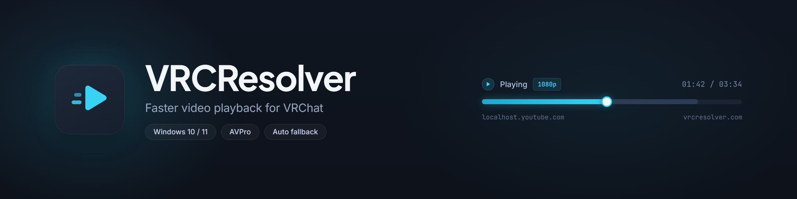

<p align="center">
  
</p>

<p align="center">
  <a href="https://github.com/RealWhyKnot/VRCResolver/actions/workflows/ci.yml"></a>
  <a href="https://github.com/RealWhyKnot/VRCResolver/releases/latest"></a>
  <a href="https://github.com/RealWhyKnot/VRCResolver/releases"></a>
  <a href="https://vrcresolver.com"></a>
  
  <a href="LICENSE"></a>
</p>

<p align="center">
  <a href="https://github.com/RealWhyKnot/VRCResolver/releases/latest">Download</a> ·
  <a href="https://vrcresolver.com">Website</a> ·
  <a href="https://github.com/RealWhyKnot/VRCResolver/issues/new/choose">Report a bug</a> ·
  <a href="CHANGELOG.md">Changelog</a> ·
  <a href=".github/SECURITY.md">Security</a>
</p>

VRCResolver makes videos in VRChat load faster and fail less. It replaces VRChat's slow, flaky video resolver with one backed by [vrcresolver.com](https://vrcresolver.com), and if that can't resolve a link it falls back to resolving YouTube links on your PC, then to VRChat's original `yt-dlp`.

It is alpha software and runs on 64-bit Windows 10 and 11. It was called WKVRCProxy before.

## What it does

- Resolves the links you paste into in-world video players on a server instead of your PC.
- Gets higher quality streams where VRChat's stock resolver often returns a low-quality one.
- Serves streams from an address VRChat's video player (AVPro) trusts, so they play in public worlds.
- Falls back if something breaks. If `vrcresolver.com` can't resolve a link or can't be reached, it resolves locally, and after that it hands the link to VRChat's stock `yt-dlp`.
- Doesn't bypass DRM, host any content, or log in to YouTube.

## How it works

VRChat plays videos by running a small program called `yt-dlp.exe` that turns a page link into a stream URL. VRCResolver sits in that spot:

1. VRChat runs `Tools/yt-dlp.exe`, which is now a small wrapper. The original is backed up next to it as `yt-dlp-og.exe`.
2. The wrapper passes the link to the `vrcresolver.exe` app running on your PC.
3. `vrcresolver.exe` asks `vrcresolver.com` for the stream URL, then serves the video to VRChat from `localhost.youtube.com`. That name points at your own PC and is one AVPro trusts.
4. If the server can't resolve the link, `vrcresolver.exe` tries YouTube from your PC. If that fails too, the wrapper runs `yt-dlp-og.exe`, so VRChat behaves the way it did before.

`vrcresolver.com` is a hosted service run by WhyKnot. Its server code is private, so it can't be self-hosted.

## Install

1. Launch VRChat once. The installer needs `Tools/yt-dlp.exe` to exist so it can back it up.
2. Download the latest `vrcresolver-*.zip` from the [releases page](https://github.com/RealWhyKnot/VRCResolver/releases/latest) and extract it anywhere except `Program Files`.
3. Run `vrcresolver.exe`. Windows asks for admin permission (UAC) once, because VRCResolver adds `127.0.0.1 localhost.youtube.com` to your hosts file. Public-world playback needs that entry.
4. Launch VRChat. When the console says `Ready.`, paste a video link into any in-world player.

Keep `vrcresolver.exe` running while you play. When it tells you a new version is out, type `update` in its console to install it.

## Uninstall

`vrcresolver.Uninstaller.exe` does not ask for confirmation. When you run it, it restores the original `yt-dlp.exe` from `yt-dlp-og.exe`, removes the hosts entry, and deletes `%USERPROFILE%\AppData\LocalLow\vrcresolver\`.

## Troubleshooting

The console prints one line per video:

- `Playing` (green): VRCResolver handled it.
- `Skipped` (yellow): VRChat's own `yt-dlp` handled it instead. The line says why.
- `Failed` (red): neither worked.

If nothing plays in VRChat:

1. Check that `vrcresolver.exe` is running and its console said `Ready.`.
2. If you missed or declined the UAC prompt, type `repair` in the console. Without the hosts entry, public worlds won't play.
3. Read the reason on any `Skipped` or `Failed` line.
4. For a clean reinstall, run `vrcresolver.Uninstaller.exe`, launch VRChat once, then extract a fresh release and run `vrcresolver.exe` again.

Logs are in `%USERPROFILE%\AppData\LocalLow\vrcresolver\logs\`. When you report a bug, include the lines for the video that failed.

## Building from source

You need Windows 10 or 11 x64, the stable Rust toolchain with the Visual Studio C++ build tools, PowerShell 5.1 or newer, and Git.

```powershell
git clone https://github.com/RealWhyKnot/VRCResolver.git
cd VRCResolver
powershell -ExecutionPolicy Bypass -File build.ps1
```

The build puts its output in `dist\`. [CONTRIBUTING.md](CONTRIBUTING.md) covers the checks and how to propose changes.

## Privacy, terms, and support

The links you paste are sent to `vrcresolver.com` along with the player type and a maximum video height. The server also sees your IP address and ordinary request details, and keeps its logs encrypted for 30 days. There are no accounts, cookies, or analytics. If the server can't resolve a YouTube link, your PC asks YouTube directly, and YouTube sees your IP address. Your client logs stay on your PC. The details are in [PRIVACY.md](PRIVACY.md) and [TERMS.md](TERMS.md), which update automatically when the site's versions change.

For bugs, [open an issue](https://github.com/RealWhyKnot/VRCResolver/issues/new/choose). Report security problems privately as described in [SECURITY.md](.github/SECURITY.md). Please follow the [code of conduct](CODE_OF_CONDUCT.md).

## License

GPL-3.0-or-later. See [LICENSE](LICENSE) for the full text and [NOTICE](NOTICE) for third-party attributions.
