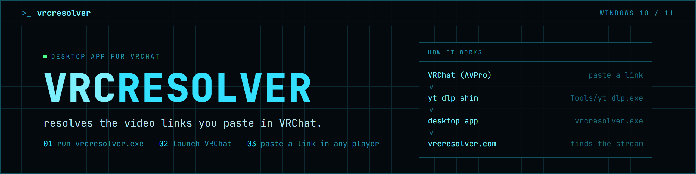

<p align="center">
  
</p>

<p align="center">
  <a href="https://github.com/RealWhyKnot/VRCResolver/actions/workflows/ci.yml"></a>
  <a href="https://github.com/RealWhyKnot/VRCResolver/releases/latest"></a>
  <a href="https://vrcresolver.com"></a>
  
  <a href="LICENSE"></a>
</p>

<p align="center">
  <a href="https://github.com/RealWhyKnot/VRCResolver/releases/latest">Download</a> ·
  <a href="https://vrcresolver.com">Website</a> ·
  <a href="https://github.com/RealWhyKnot/VRCResolver/issues/new?template=bug_report.yml">Report a bug</a> ·
  <a href="CHANGELOG.md">Changelog</a> ·
  <a href=".github/SECURITY.md">Security</a>
</p>

VRChat plays videos through yt-dlp. Stock yt-dlp is slow, breaks whenever YouTube changes something, and returns URLs that AVPro blocks in public worlds. VRCResolver replaces VRChat's `Tools/yt-dlp.exe` with a patched build that resolves videos through vrcresolver.com and serves them from a local address AVPro trusts. If anything fails, it falls back to VRChat's original yt-dlp. Playback is never worse than stock.

Formerly WKVRCProxy.

## What you get

Streams come from `localhost.youtube.com:{port}`, which is on AVPro's trust list, and that's what makes them play in public worlds. Videos are resolved on the server instead of your PC. Regional blocks and rate limits on your connection don't apply, and the server updates its yt-dlp nightly. A new URL takes 2-3 seconds and a repeat about 20 ms. You get 1080p HLS instead of 360p mp4. Any failure hands the URL to VRChat's original yt-dlp.

It doesn't bypass DRM, host any content or log in to YouTube.

## Install

1. Launch VRChat once. The patcher needs `Tools/yt-dlp.exe` to exist so it can back it up.
2. Download the latest `vrcresolver-*.zip` release and extract it anywhere except `Program Files`.
3. Run `vrcresolver.exe` and accept the one-time UAC prompt. It adds `127.0.0.1 localhost.youtube.com` to your hosts file, which public-world playback needs.
4. Launch VRChat. When the console shows `[mesh] connected`, paste a video URL into any in-world player.

To update, type `/update` in the console.

To uninstall, run `vrcresolver.Uninstaller.exe`. It restores the original `yt-dlp.exe`, removes the hosts entry and deletes `%LOCALAPPDATA%Low\vrcresolver\`. It doesn't ask for confirmation.

Needs 64-bit Windows 10 or 11.

## Troubleshooting

The console prints one line per resolve: green means resolved, yellow means it fell back to stock yt-dlp, red is an error. Full logs are in `%LOCALAPPDATA%Low\vrcresolver\logs\`. When you file a bug, include the correlation-ID block for the failed resolve.

## How it works

```
VRChat (AVPro)
   v  paste URL
Tools/yt-dlp.exe        patched shim
   v  named pipe
vrcresolver.exe         watchdog
   v  WebSocket
vrcresolver.com         remote resolver
```

The resolved stream comes back through the watchdog's local listener at `http://localhost.youtube.com:{port}/play/<session>/manifest.<ext>?target=...`. If any link in that chain breaks, the shim runs the backed-up `yt-dlp-og.exe` instead.

## Building from source

[CONTRIBUTING.md](CONTRIBUTING.md) covers setup, the build script and the checks a pull request has to pass.

## Terms and privacy

The app resolves the links you paste through vrcresolver.com, so the site's [terms of service](TERMS.md) and [privacy policy](PRIVACY.md) apply. The copies in this repo update automatically when the site's versions change.

## License

GPL-3.0-or-later. See [LICENSE](LICENSE) for the full text and [NOTICE](NOTICE) for third-party attributions.
